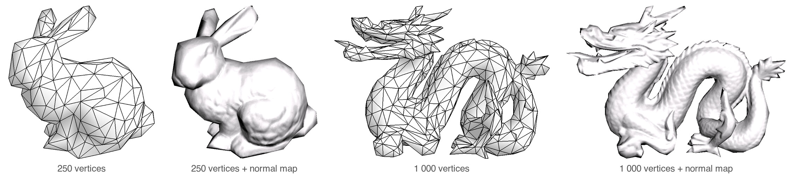
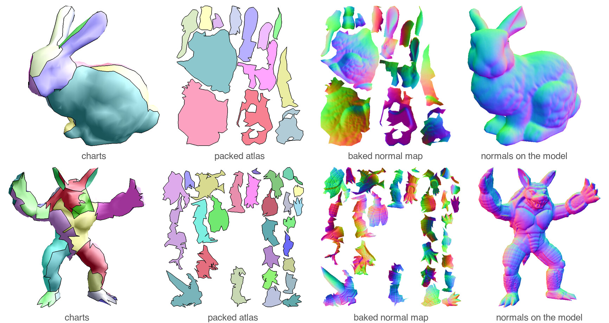
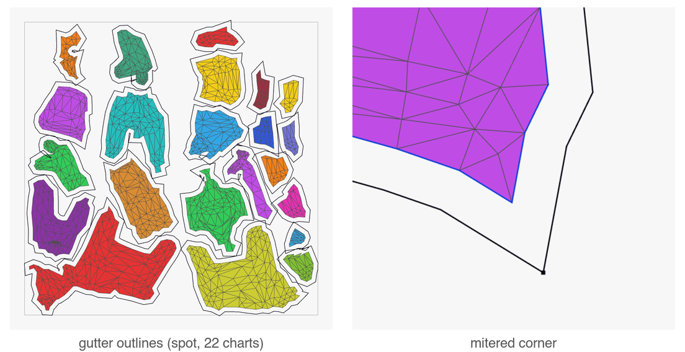
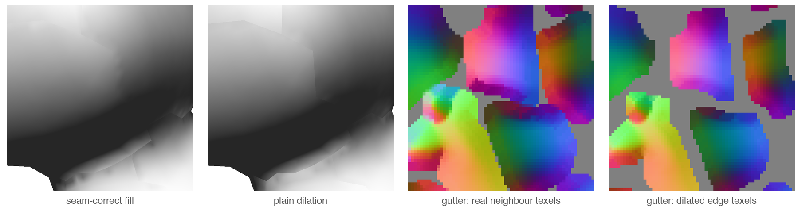
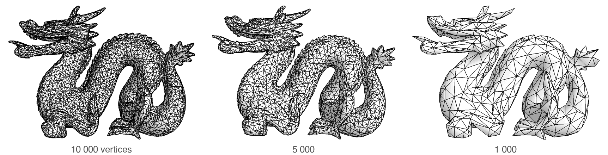

# decimate

Reduce a mesh to a few hundred vertices, keep its look with a baked normal map.



My diploma thesis from 2003, ported to C++20. Maybe it's useful to someone.


## How it works



```
load        OBJ / Open Inventor
reduce      QEM edge collapse
chartify    curvature-driven region growing
flatten     LSCM
pack        rotated-horizon packing, mitered gutter
bake        raytraced normals, seam-correct gutter fill
```

## Chart borders

**Mitered gutter.** Each chart outline is offset outward along its averaged edge
normals, clamped at sharp corners.



**Seam-correct fill.** The gutter gets the real neighbour triangle across the seam
(half-edge `sym`), not dilated edge texels. Bilinear filtering at a seam samples
matching texels.



## Simplification



Garland–Heckbert quadrics, guarded against fold-overs and slivers.

## Components

No OpenGL, no OS, no globals in the core. Link only what you need:

| Target | |
|---|---|
| `decimate::math` | vectors, matrices, CG / sparse solvers |
| `decimate::types` | `MeshData`, `Face` |
| `decimate::mesh` | half-edge mesh |
| `decimate::io` | OBJ, Open Inventor |
| `decimate::reduce` | `MeshData → MeshData` |
| `decimate::chart` | segmentation, LSCM, packing |
| `decimate::bake` | normal-map bake, object / tangent space |
| `decimate::raytracing` | ray / triangle |
| `decimate::all` | everything |

## Build

CMake ≥ 3.21, C++20. Tested on macOS; Linux should work; Windows untested.

```sh
cmake -S . -B build -DCMAKE_BUILD_TYPE=Release
cmake --build build -j
ctest --test-dir build
build/ui/mesh-viewer                 # opens model/spot.obj
build/ui/mesh-viewer --shot out/     # writes each panel as an image
```

Libraries only: `-DMESH_BUILD_UI=OFF -DDECIMATE_BUILD_TESTS=OFF` (no downloads, no
OpenGL). The viewer needs OpenGL and fetches GLFW; tests fetch Catch2. Without a
build type CMake builds unoptimized.

## Use

```cmake
find_package(decimate 0.6 REQUIRED COMPONENTS reduce)
target_link_libraries(myapp PRIVATE decimate::reduce)
```

```cpp
#include <decimate/reduce/reducer.h>

decimate::MeshData low = decimate::reduce(high, 2000);   // target vertex count
```

## Models

Only `model/spot.obj` (CC0) is bundled. The rest has its own license:

```sh
tools/fetch_models.sh            # bunny, horse
tools/fetch_models.sh --bench    # + Armadillo, dragon
```

Tests without their model are skipped. Details: `model/README.md`.

## Preconditions

- Faces: 3 ints per triangle, CCW, 0-based.
- reduce: manifold triangle mesh; open boundaries are fine.
- flatten: charts are disks — chartify makes them so.
- UVs: per corner (`3 × faceCount`); the per-vertex overload is lossy at seams.
- Loaders throw `std::runtime_error` on out-of-range indices.

`chart` and `bakeSeamFill` take a `HalfEdgeMesh`; 0.7 switches them to `MeshData`.

## Known limitations

- Thin two-sided parts (bunny ears) scramble at very low targets.
- `reduce()` stops early at extreme targets: rejected collapses are not retried.
- OBJ: positions and faces only; `vt`/`vn` are misread as positions, `f a/b/c`
  keeps `a`, one object per file.
- Windows and WebAssembly not built yet.

## License

MIT. The 2003 source is kept in `legacy2003/`.

Thesis renders of the Stanford bunny, dragon and armadillo — models from the
[Stanford 3D Scanning Repository](https://graphics.stanford.edu/data/3Dscanrep/).
Spot by Keenan Crane (CC0).
