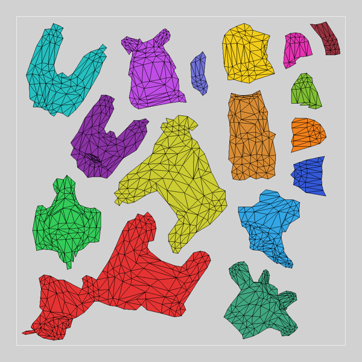
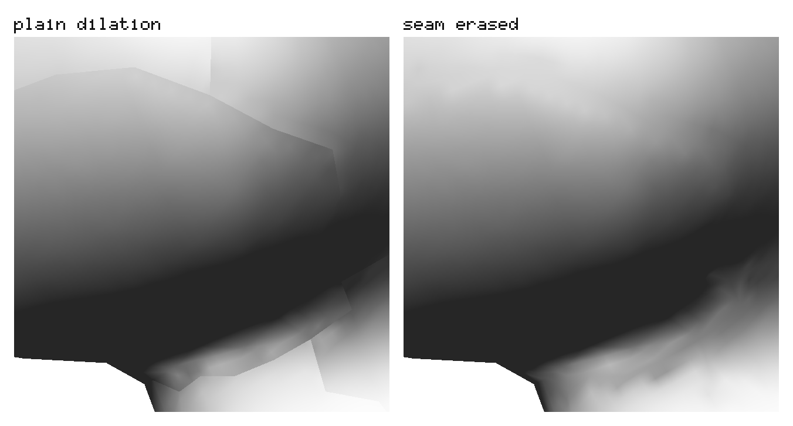
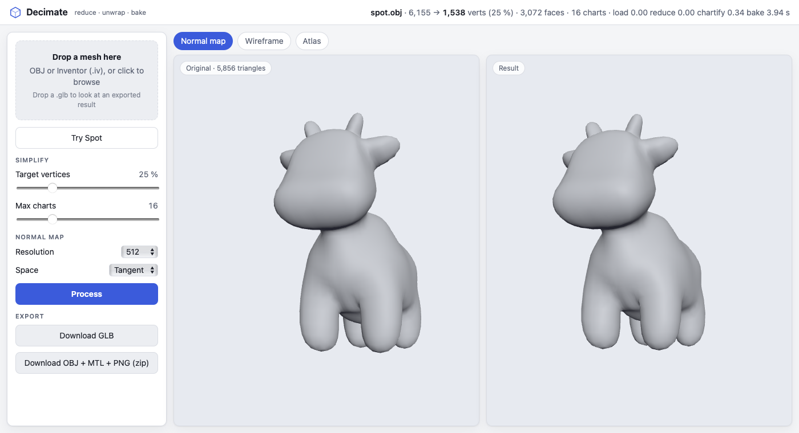

# decimate

Reduce a mesh to a few hundred vertices, keep its look with a baked normal map.


My diploma thesis from 2003, ported to C++20. Maybe it's useful to someone.
The core also compiles to WebAssembly: a [web tool](#web-tool) runs the whole pipeline in the browser.


## How it works


```
load        OBJ / Open Inventor
reduce      QEM edge collapse
chartify    curvature-driven region growing
flatten     bijective, free boundary (Smith & Schaefer 2015); LSCM optional
pack        rotated-horizon packing, mitered gutter
bake        raytraced normals, seamless gutter (seam erasure, Liu et al. 2017)
```

## Flattening



Every chart is flattened with Smith & Schaefer's free-boundary method: it minimises the
symmetric Dirichlet energy with a barrier that keeps the map bijective at every step — no
flipped triangle, no boundary crossing itself, and the outline is free to take whatever
shape distorts least. LSCM (`Flattener::Lscm`) is kept as the fast alternative.

| Spot, 16 charts | max chart stretch L2 | L∞ |
|---|---|---|
| LSCM | 1.114 | 6.79 |
| bijective | **1.011** | **1.79** |

(Sander et al. 2001 stretch; 1 = isometric.)

## Chart borders

**Mitered gutter.** Each chart outline is offset outward along its averaged edge
normals, clamped at sharp corners.


**Seam-correct fill.** The gutter gets the real neighbour triangle across the seam
(half-edge `sym`), not dilated edge texels. Bilinear filtering at a seam samples
matching texels.


**Seam erasure.** In object space the texels along every seam are solved so both sides of
the seam interpolate to the same value (Liu et al. 2017, section 4): the seam mismatch drops
from ~2.5e-3 to ~1e-10 per channel on Spot. Tangent space is erased too, frame-aware: the
MikkTSpace bases differ across a seam, so the solve matches the decoded normals, not the
raw texel values (bunny: seam mismatch 3.3e-3 → 8.4e-6). Both spaces share one sparse
block-LDLᵀ solver. `Gutter::Seamless`, the default, is erasure in both spaces.



## Simplification


Garland–Heckbert quadrics, guarded against fold-overs and slivers.

## Components

No OpenGL, no OS, no globals in the core. Link only what you need:

| Target | |
|---|---|
| `decimate::math` | vectors, matrices, CG / sparse solvers |
| `decimate::types` | `MeshData`, `Face` |
| `decimate::mesh` | half-edge mesh |
| `decimate::io` | OBJ, Open Inventor |
| `decimate::reduce` | `MeshData → MeshData` |
| `decimate::chart` | segmentation, bijective / LSCM flattening, packing |
| `decimate::bake` | normal-map bake, object / tangent space |
| `decimate::seam` | seam erasure, seam straightening, seam metric |
| `decimate::pipeline` | `chartify` + `bakeAtlas`: the whole pipeline in two calls |
| `decimate::raytracing` | ray / triangle |
| `decimate::all` | everything |

## Build

CMake ≥ 3.21, C++20. Tested on macOS; Linux should work; Windows untested.

```sh
cmake -S . -B build -DCMAKE_BUILD_TYPE=Release
cmake --build build -j
ctest --test-dir build
build/ui/mesh-viewer                 # opens model/spot.obj
build/ui/mesh-viewer --shot out/     # writes each panel as an image
```

Libraries only: `-DMESH_BUILD_UI=OFF -DDECIMATE_BUILD_TESTS=OFF` (no downloads, no
OpenGL). The viewer needs OpenGL and fetches GLFW; tests fetch Catch2. Without a
build type CMake builds unoptimized.

## Use

```cmake
find_package(decimate 0.7 REQUIRED COMPONENTS reduce)
target_link_libraries(myapp PRIVATE decimate::reduce)
```

```cpp
#include <decimate/reduce/reducer.h>

decimate::MeshData low = decimate::reduce(high, 2000);   // target vertex count
```

The whole pipeline (`decimate::pipeline`):

```cpp
#include <decimate/pipeline.h>

auto atlas = decimate::chartify(low);                    // charts, flattened and packed, UV per corner
auto baked = decimate::bakeAtlas(atlas, high);           // normal map, seamless gutter
// baked.map.pixels: RGB8, baked.map.width × baked.map.height; atlas.uv: 3 per face
```

## Models

Only `model/spot.obj` (CC0) is bundled. The rest has its own license:

```sh
tools/fetch_models.sh            # bunny, horse
tools/fetch_models.sh --bench    # + Armadillo, dragon
```

Tests without their model are skipped. Details: `model/README.md`.

## Web tool



The core compiled to WebAssembly plus a static page (`web/`, no build step, no framework): drop an OBJ or
Inventor file, get the reduced, unwrapped mesh with its baked normal map, and download it as GLB or
OBJ + MTL + PNG (one zip). Everything runs in the browser; three.js is vendored (`web/vendor/`, MIT,
pinned 0.170.0), nothing is fetched from a CDN, no SharedArrayBuffer is needed, so any static host works.

```sh
# needs Emscripten (brew install emscripten)
emcmake cmake -S . -B build-wasm -DCMAKE_BUILD_TYPE=Release
cmake --build build-wasm -j
cmake --build build-wasm --target web      # copies decimate.js / decimate.wasm into web/
python3 -m http.server -d web 8000         # open http://localhost:8000
```

GLB needs a tangent-space map (glTF has no object-space slot). The normal map is exported in the glTF/OpenGL
green-up convention; the viewer shows the core's own data. A `.glb` dropped on the page is displayed in the
result pane (round-trip check). Both panes read the input through the core loader (OBJ and Inventor alike).
Tests: `ctest --test-dir build-wasm` runs W1/W2 and W3/W4 (`npm ci` in `web/test` first, else skipped).

The Wasm module (`wasm/`, an ES6 module factory, ~600 KB) can be used without the page:

```js
import createDecimate from "./decimate.js";
const mod = await createDecimate();
const r = mod.process("spot.obj", bytes, { targetRatio: 0.25, maxCharts: 16, resolution: 512, tangentSpace: true });
// r.positions, r.indices, per-corner r.uv / r.normals / r.tangents, r.map {width, height, rgb}, r.stats
const m = mod.loadMesh("bunny.iv", bytes);          // the input as the core reads it: {positions, indices}
```

Errors (malformed file, bad options) are thrown as JS `Error` with the C++ message. Single-threaded, so
roughly 2-3x slower than native; up to 4 GB of memory (tangent space at 1024 needs ~2.8 GB).

## Preconditions

- Faces: 3 ints per triangle, CCW, 0-based.
- reduce: manifold triangle mesh; open boundaries are fine.
- flatten: charts are disks — chartify makes them so.
- UVs: per corner (`3 × faceCount`); the per-vertex overload is lossy at seams.
- Loaders throw `std::runtime_error` on out-of-range indices.

`chart` and `bakeSeamFill` take a `HalfEdgeMesh`; `decimate::pipeline` takes `MeshData`.

## Known limitations

- Thin two-sided parts (bunny ears) scramble at very low targets.
- `reduce()` stops early at extreme targets: rejected collapses are not retried.
- OBJ: positions and faces only; `vt`/`vn` are misread as positions, `f a/b/c`
  keeps `a`, one object per file.
- Windows not built yet.

## References

- J. Smith, S. Schaefer. *Bijective Parameterization with Free Boundaries.* ACM Trans.
  Graph. 34(4), SIGGRAPH 2015.
- S. Liu, Z. Ferguson, A. Jacobson, Y. Gingold. *Seamless: Seam erasure and seam-aware
  decoupling of shape from mesh resolution.* ACM Trans. Graph. 36(6), Article 216, 2017.
- P. Sander, J. Snyder, S. Gortler, H. Hoppe. *Texture Mapping Progressive Meshes.*
  SIGGRAPH 2001 (stretch metric).
- M. Mikkelsen. *Simulation of Wrinkled Surfaces Revisited.* Master's thesis, University of
  Copenhagen, 2008 (MikkTSpace; `mikktspace.c`, zlib licence, fetched at configure time).
- J. R. Shewchuk. *Adaptive Precision Floating-Point Arithmetic and Fast Robust Geometric
  Predicates.* Discrete & Computational Geometry 18(3), 1997 (public domain).
- M. Garland, P. Heckbert. *Surface Simplification Using Quadric Error Metrics.* SIGGRAPH 1997.
- B. Lévy, S. Petitjean, N. Ray, J. Maillot. *Least Squares Conformal Maps for Automatic
  Texture Atlas Generation.* SIGGRAPH 2002.

## License

MIT. The 2003 source is kept in `legacy2003/`.

Thesis renders of the Stanford bunny, dragon and armadillo — models from the
[Stanford 3D Scanning Repository](https://graphics.stanford.edu/data/3Dscanrep/).
Spot by Keenan Crane (CC0).
